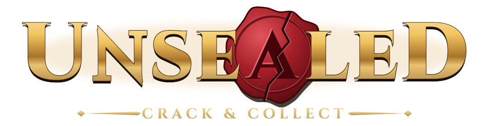
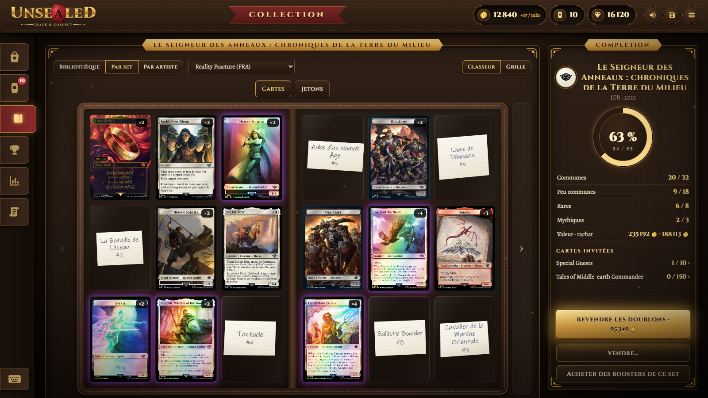
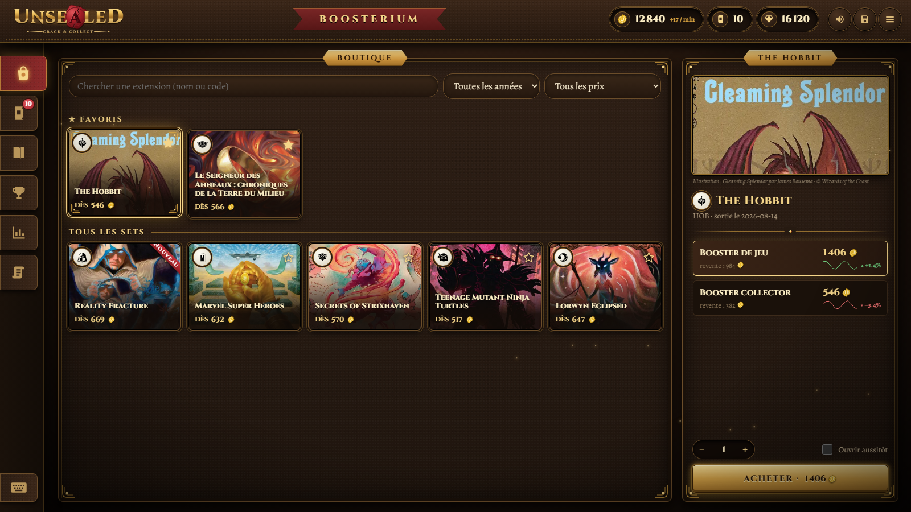
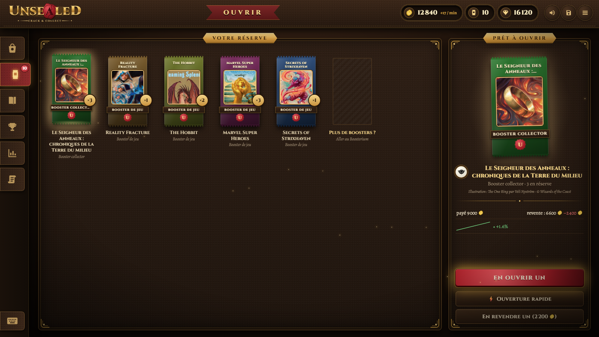
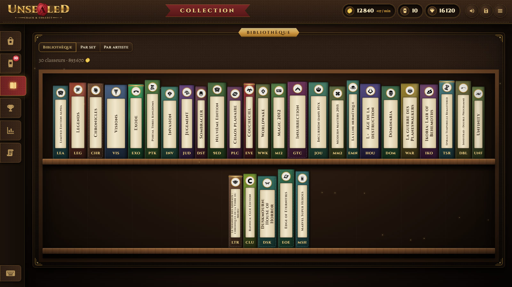
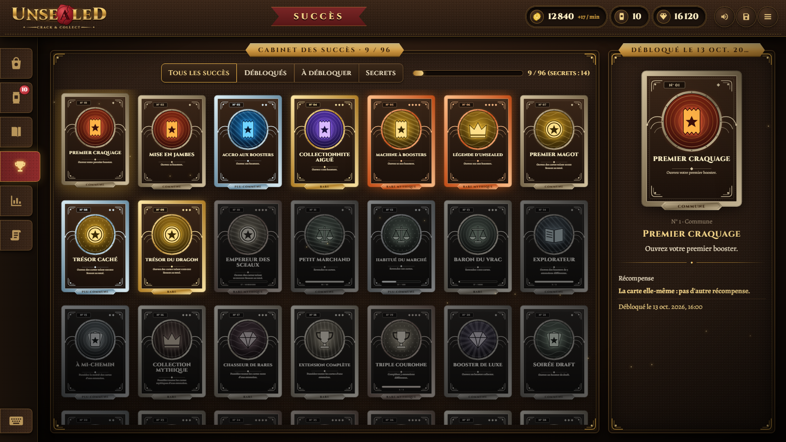

<div align="center">



### The thrill of cracking boosters open, without spending a cent.

A free, fan-made desktop game for trading card collectors: open boosters with their **real draw rates**,
watch your cards follow **real market prices**, and fill your binders. With virtual Seals only.

<br>

[](https://mrgrabazu.github.io/unsealed/)
&nbsp;
[](https://github.com/MrGrabazu/unsealed/releases/latest)
&nbsp;
[](https://discord.gg/YVRdaBGWvb)
&nbsp;
[](LICENSE)

**[🌐 mrgrabazu.github.io/unsealed](https://mrgrabazu.github.io/unsealed/)**: the showcase page, with the installer for your system.

<br>



</div>

---

## ✦ What it is

- **True draw rates.** Every booster follows its set's real make-up, from Alpha (1993) to today: about 180 sets,
  in Play, Draft, Set and Collector boosters, each configuration checked by simulating 100,000 boosters.
- **Market prices.** Cards are worth today's price. Sell them back at the **Boosterium**, hunt the pull that pays
  for the pack, and watch your collection's value grow. It even earns you a little every minute.
- **Opening, for real.** Tear the wrapper open in 3D, slide the cards one by one, in a real booster's order, with
  shimmering foils and sounds. Or open them quickly, ten or a hundred at a time.
- **A collection to complete.** A library of binders, one per set; guest series (Special Guests, The List…);
  collections by artist; missing cards written on scraps of paper.
- **96 achievements.** Each one unlocks a card of its own, drawn for the game, from the first steps to the secret ones.
- **Bets on your boosters**, in Seals, at the true odds of the draw.
- **5 languages** for the interface (English, French, German, Spanish, Italian), and cards in Japanese too.

## ✧ 100% free, 100% virtual

No purchases, no ads, no paywall. You play with **Seals**, a made-up currency that nothing turns into real money,
and cards can't be exchanged for anything real. That's the whole point: the joy of the pull, not the bill.

## 🖼️ In the game

<div align="center">

| | |
|:---:|:---:|
| <br>**The Boosterium** | <br>**The booster reserve** |
| <br>**The library** | <br>**The achievements cabinet** |

</div>

## ⬇️ Install

Get the installer for your system on **[the showcase page](https://mrgrabazu.github.io/unsealed/)**, or straight
from the **[latest release](https://github.com/MrGrabazu/unsealed/releases/latest)**.

| System | File | First launch |
|---|---|---|
| **Windows** 10 / 11 | `Unsealed_…_x64-setup.exe` | Not signed with a paid certificate: on "Windows protected your PC", click *More info* → *Run anyway*. |
| **macOS** (Apple silicon & Intel) | `Unsealed_…_universal.dmg` | Not notarized by Apple: right-click Unsealed → *Open*, or `xattr -cr /Applications/Unsealed.app` if it is said to be damaged. |
| **Linux** | `Unsealed_…_amd64.AppImage`, `.deb`, `.rpm` | The AppImage runs anywhere (`chmod +x`, then run it) and updates itself. |

On first launch, the game prepares its data (a few minutes, online). From then on, **it updates itself** from the home screen.

## 🛠️ Under the hood

| | |
|---|---|
| **Desktop shell** | [Tauri 2](https://tauri.app) (installers, signed in-app updates) |
| **Game logic** | Rust: seeded weighted draws, rate simulation, economy, event-driven achievements, SQLite saves |
| **Interface** | React + Vite, a 3D opening with three.js / react-three-fiber, sounds synthesized with the Web Audio API |
| **Data** | Built on the player's machine from [MTGJSON](https://mtgjson.com) (sets and booster contents) and [Scryfall](https://scryfall.com) (cards, images, daily prices) |

The repository: `core/` (the `unsealed-core` crate: parsing, draws, simulation, data builder), `data-builder/`
(the same builder from the command line), `app/` (the React front end and its Tauri shell), `config/` (economy,
achievements, data: every balancing value lives here), `site/` (the showcase page).

<details>
<summary><b>Build from source</b></summary>

<br>

Requires Rust (stable), Node.js 20+ and, on Linux, Tauri's system libraries.

```sh
# Game data (sets, prices) into dist/: the app also builds it by itself at launch
cargo run --release -p data-builder -- --sets all

# The app, in development
npm --prefix app install
npm --prefix app run tauri dev

# Tests
cargo test --workspace
```

A version is published by pushing a tag `vX.Y.Z`: GitHub Actions builds and signs the installers for the three
systems and creates the release.

</details>

## ⚖️ License

| What | License |
|---|---|
| **The source code** | [GNU GPL v3.0 or later](LICENSE): reuse and modify it freely, but any version you distribute stays under the GPL, with its source code published. |
| **The artwork, visual identity and texts** (logo, icon, card back, wrappers, achievement cards, screenshots, page and README texts) | [CC BY-NC-SA 4.0](LICENSE-ASSETS): share and adapt them for non-commercial purposes, crediting *Unsealed, by MrGrabazu*, under the same license. |
| **The name and logo as marks** | Not licensed: don't present another game or version as Unsealed. |

The fonts (Cinzel, Alegreya) stay under the SIL Open Font License. Magic: The Gathering cards, images and names belong
to Wizards of the Coast; card data and prices come from Scryfall and MTGJSON, under their own terms. See
[LICENSE-ASSETS](LICENSE-ASSETS) for the details.

## 💬 Community

Join **The Boosterium** on [Discord](https://discord.gg/YVRdaBGWvb) to share your best pulls, report a bug or suggest a feature.
Issues and ideas are welcome here too.

<details>
<summary><b>🇫🇷 En français</b></summary>

<br>

**Unsealed** est un jeu de fan gratuit qui reproduit le plaisir d'ouvrir des boosters, sans dépenser un centime :
des taux de tirage fidèles à chaque set (près de 180, d'Alpha à aujourd'hui), des cartes au prix du marché, une
bibliothèque de classeurs à compléter, 96 succès avec leurs propres cartes, et une monnaie fictive, les **Sceaux**,
que rien ne convertit en argent réel. Interface en français, anglais, allemand, espagnol et italien.

**Téléchargement** pour Windows, macOS et Linux sur la [page du jeu](https://mrgrabazu.github.io/unsealed/) ;
la communauté se retrouve sur [Discord](https://discord.gg/YVRdaBGWvb).

</details>

---

<div align="center">
<sub>

Unsealed is unofficial Fan Content permitted under the Fan Content Policy. Not approved/endorsed by Wizards.
Portions of the materials used are property of Wizards of the Coast. ©Wizards of the Coast LLC.
<br>
Card images and prices from [Scryfall](https://scryfall.com) · set and booster data from [MTGJSON](https://mtgjson.com) ·
Cinzel and Alegreya fonts under the SIL Open Font License.

</sub>
</div>
